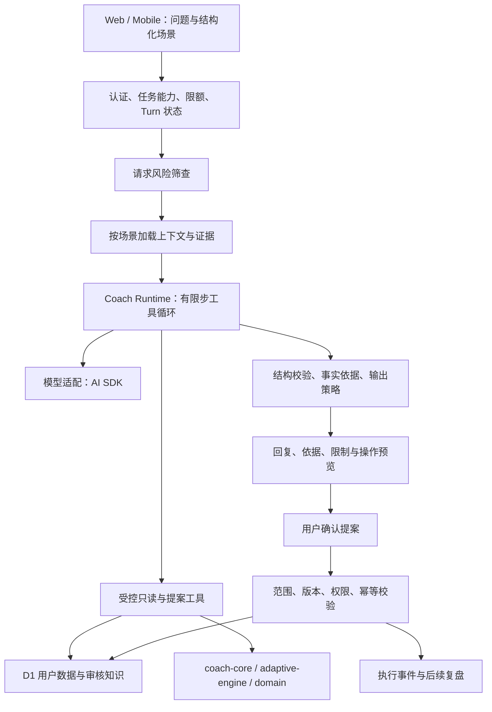

# 真实 AI 教练：现状核查、开源选型与模块设计

调研日期：2026-10-22。状态：设计基线；前两个切片已实现，2026-10-23 已完成 ai.chwjh.com + 真实 Worker/D1 的今日训练调整验收，见 [接入记录](MODEL_HUB_COACH_INTEGRATION.zh-CN.md)。本文下方的现状核查保留调研时快照。

依据：当前工作区代码（包含已有未提交修改）、官方文档和项目官方仓库。本文区分代码已实现、运行已验证与建议新增；没有安装候选框架，没有调用付费模型，也没有修改业务代码。公开部署的 health 接口本次无法通过浏览工具访问，因此不对线上模型配置和可用性下结论。

## 1. 结论

当前系统已经有真实模型调用、流式回复、训练历史上下文、语义摘要、知识检索和可确认的操作提案，不能概括成“全部是伪 AI”。用户看到规则式体验也有明确原因：前台只有在 **已登录且探测到 AI 能力** 时才进入 AI 对话，否则使用本地规则教练。

更准确的定位是：**有真实 LLM 接口和部分闭环，但缺少经真实模型验证的、能按需查数据和执行精确操作的教练运行层。** 接上 API 不等于教练质量已经成立。

推荐组合：

- **首期：Vercel AI SDK Core + Zod + 项目现有规则引擎 + D1 + promptfoo。** 统一模型协议，提供受限工具调用，保留已有数据和业务边界。
- **可观测：先完善现有 generation/evaluation 数据，再通过可替换的追踪出口接 Langfuse。** 不让外部平台成为回复成功的依赖。
- **后台跟进：有明确长任务需求时，再引入 Cloudflare Agents / Workflows。** 首期普通对话不必迁移到 Durable Objects。
- **Mastra、LangGraph JS 是备选编排方案。** 暂不和 Cloudflare Agents 叠加，也不整体替换当前服务端。

现有训练剂量、递进和恢复判断继续由领域引擎提供。LLM 应负责理解表达、发现缺失信息、选择查询、比较候选方案和解释取舍；所有改变训练状态的操作经过服务器校验和明确确认。

## 2. 代码实际实现到哪里

下列路径与行号对应本次检查时的工作区，后续修改可能使行号移动。

| 能力 | 已有实现 | 尚不能据此证明什么 |
| --- | --- | --- |
| 无模型教练 | `packages/product-state/src/coach-rules.ts`：七类固定意图、动作指导、替代动作、缩短训练；明确标记 `source: rules` | 不能自由理解问题，也不读取训练历史 |
| 前台选择模式 | `app/features/coach/coach-page-client.tsx:77`：`signedIn && aiAvailable` | 规则体验不代表后端不存在真实模型 |
| 真实模型请求 | `worker/llm.ts:338`、`:431`：实际 fetch、结构化输出、上游 SSE 解析；含 OpenAI、Cloudflare 和 compatible 分支 | 没有真实凭据与端到端调用记录，不能证明部署可用 |
| 训练计划生成 | `worker/llm.ts:643`：规则计划提供边界，模型选择动作与生成说明，结果经过领域校验 | 不是让模型任意编排所有剂量和数值 |
| 个性化上下文 | `worker/modules/coach.ts:58`：资料、计划、28 天训练、组记录、14 天营养、测量、复盘、健康摘要 | 当前是固定查询窗口，不能随问题主动补查任意历史 |
| 对话生成 | `worker/llm.ts:749`：`reply / intent / safety_flag / basis / actions` | 一个大 JSON 调用还不是工具执行循环 |
| 知识检索 | `worker/modules/knowledge.ts:25`：审核内容、词法评分、embedding 与余弦混合检索 | 没有证据表明引用一定支持回复中的每项主张 |
| 长期记忆 | `worker/modules/coach-orchestrator.ts:121`、`:144`：资料记忆、用户声明记忆、可删除设置 | 所检查路径没有自动提取并治理长期记忆的完整流程；对话摘要不能替代它 |
| 语义摘要 | `worker/modules/coach-orchestrator.ts:184`：定期调用专用摘要模型，失败使用片段摘要 | 降级摘要并非语义理解，且当前更新仍被主请求 await |
| 操作闭环 | `worker/modules/coach.ts:221`：提案确认、过期检查、版本检查、计划草稿、缩短/改期/记录草稿等 | 操作粒度、并发幂等和语义正确性仍需加强 |
| 适应性训练 | `services/adaptive-engine/src/index.ts`：双重递进、RIR、疲劳与停滞判断；`worker/modules/reviews.ts` 实际调用 | 确定性算法是有效领域实现；它的存在不等于模型是假的 |
| 质量记录 | `coach_evaluation_runs`、`generation_runs`、用户反馈表 | 当前记录的通过标记不等于经过教练质量评测 |

本次执行：

```text
node --experimental-strip-types --test tests/coach-rules.test.mjs tests/llm-contract.test.mjs tests/adaptive-engine.test.mjs tests/closed-loop.test.mjs
结果：40 passed，0 failed。
```

覆盖规则回答、计划约束、适应性决策与部分源码/迁移契约。没有覆盖真实供应商推理质量、真实工具循环、浏览器到数据库的完整 AI 会话。

### 优先处理的具体断点

| 优先级 | 观察到的问题 | 对模块设计的要求 |
| --- | --- | --- |
| P0 | `aiServices()` 认为 compatible 配置能启用 AI；但 `coach_chat` 默认路由只有 Cloudflare / OpenAI。数据库中的显式路由可以补齐，默认配置仍不一致 | 按任务解析实际可用路由，分别暴露 chat / planner / vision 能力与失败原因 |
| P0 | 前台保存了 `planId/dayIndex/exerciseId` 上下文，发送 AI 消息时 body 只有 `message/clientMutationId`；API 也没有接这些字段 | 结构化上下文贯穿请求，服务端检查归属、版本与当前 occurrence，不能让模型猜“这个动作” |
| P0 | `runProviderStream()` 先输出 `reply` 文本，完整结果返回后才处理模型安全标记；外层路由失败会尝试下一条 | 明确输出审核顺序；部分输出后重试必须有 attempt/reset，防止串接两段回复；取消信号传到上游 |
| P0 | 消息去重找到用户消息后，返回会话中“最新 assistant”，没有绑定该轮回复；上游失败时用户消息已存在 | 持久化 turn 状态，精确关联请求、回复与重试，不把其他轮次回复当成本轮结果 |
| P0 | 操作先读 pending，业务副作用完成后再更新状态；唯一 execution 记录不能单独阻止并发请求重复执行副作用 | 原子领取执行权，操作具有幂等键；在业务提交时校验版本与执行状态 |
| P1 | 换动作在全周中替换首次匹配；调负荷/组数当前作用于整份 schedule；shorten 使用固定 short 模式 | 操作带 occurrence/day/exercise-instance 范围，预览由实际 patch 生成，支持真实可用时长 |
| P1 | 上下文主要整体序列化到 user JSON，模型没有可调用的读取工具；`basis` 的 label/value 由模型生成 | 按需检索，数值由工具计算，回答依据绑定服务器生成的 evidence ID |
| P1 | 知识检索仅取最多 60 篇；缺失 embedding 在聊天请求中补建 | 入库与索引放到后台，查询只做检索；审核来源、版本与语言过滤成为契约 |
| P1 | 风险事件记录失败后，同一条回复末尾仍插入 `schema_valid/safety_passed/action_valid=1` 的成功行 | 运行完成、输出校验、风险命中与质量评测分开记录，unknown 不能当 pass |
| P1 | 当前主要记录成功生成；失败、重试、放弃的路由调用也可能产生费用 | 按每次 provider attempt 记录用量，区分估算、缺失数据和真实账单 |

这些问题有些属于静态代码可见的缺口，有些需要并发、断流与故障注入测试才能确定实际影响，不应把它们全部称作已在线上复现的故障。

## 3. 开源方案调研

“成熟、好评”在这里以官方维护、发布记录、社区采用、能力文档和部署适配作可核查信号。Stars 只是关注度，不代表教练专业性或安全性。以下数值是调研时页面的近似值，不是质量排名。

### 3.1 通用 AI 基础设施

| 项目 | 社区与许可 | 适合复用的部分 | 本项目的选择 |
| --- | --- | --- | --- |
| [Vercel AI SDK](https://github.com/vercel/ai) | 约 27.4k stars；[Apache-2.0](https://raw.githubusercontent.com/vercel/ai/main/LICENSE)；[发布页](https://github.com/vercel/ai/releases)显示 7.x 与旧版本维护 | TypeScript 模型适配、流式输出、结构化数据、工具调用 | **首选模型接入层**；直接配置供应商即可，不要求托管到 Vercel |
| [Cloudflare Agents](https://github.com/cloudflare/agents) | 约 5.9k stars；MIT；[发布页](https://github.com/cloudflare/agents/releases)有持续更新，所见 `agents@0.29.0` | 基于 Durable Objects 的持久会话、调度、实时连接和工作流集成 | **Cloudflare 后台跟进的优先备选**；0.x 与部分 Beta 能力需单独做兼容验证 |
| [LangGraph JS](https://github.com/langchain-ai/langgraphjs) | JS 仓库约 3.4k stars；MIT；不能拿 Python 仓库 stars 充当 JS 采用量 | 显式图状态、checkpoint、暂停恢复、人工介入 | 需要复杂分支流程或独立 Node 服务时考虑；D1 适配需验证，不能默认现成可用 |
| [Mastra](https://github.com/mastra-ai/mastra) | 约 29k stars；核心 Apache-2.0，`ee/` 为企业许可 | TypeScript agent、workflow、memory 等较完整开发框架 | 备选一体化框架；当前已有大量同类模块，整体迁入会产生重复抽象和状态迁移 |
| [promptfoo](https://github.com/promptfoo/promptfoo) | 约 26.3k stars；MIT | 离线评测、模型横评、回归与对抗用例、CI | **首期引入评测**；运行在开发机/CI，不加入 Worker 请求路径 |
| [Langfuse](https://github.com/langfuse/langfuse) | 约 36.2k stars；核心 MIT，`ee/` 例外 | 追踪、延迟/成本、数据集、反馈与质量观测 | 可替换的观测平台；自托管服务另行部署，不塞入 Worker；先证明采集链路有效 |

能力依据：[AI SDK 官方介绍](https://ai-sdk.dev/docs/introduction)、[工具调用](https://ai-sdk.dev/docs/ai-sdk-core/tools-and-tool-calling)、[Cloudflare Agents 文档](https://developers.cloudflare.com/agents/)、[LangGraph 概览](https://docs.langchain.com/oss/javascript/langgraph/overview)与[持久化](https://docs.langchain.com/oss/javascript/langgraph/persistence)。

两个会影响实施的事实：

1. Cloudflare 当前官方方案是 `agents/models/ai-sdk` 的 `createAI`，旧 `workers-ai-provider` 已弃用；所见文档要求 `ai@^7`、`@ai-sdk/provider@^4`。但 Models 相关部分标注 Beta：首期可先使用 AI SDK 的供应商直连适配，把 Cloudflare 适配放在同一接口后。引入模型适配包不意味着必须迁移到 Agent/Durable Object 运行时。见 [Workers AI 接入文档](https://developers.cloudflare.com/workers-ai/configuration/ai-sdk/)与[Agents AI SDK 文档](https://developers.cloudflare.com/agents/models/ai-sdk/)。
2. Mastra **有**官方 Cloudflare deployer，不能简单说不支持 Workers；不过官方明确要求存储持久化到外部，文件式本地存储不适用。是否能复用现有 D1 schema，需要单独验证。见 [Mastra Cloudflare 部署](https://mastra.ai/integrations/deploy/cloudflare)。LangGraph 的内存 checkpointer 同样不能当生产持久化。

Langfuse 接入也应锁定 SDK 与服务端版本；当前官方文档已采用 OpenTelemetry，并列出版本兼容关系和旧 ingestion 接口迁移时间。不要复制旧版埋点示例。见 [Langfuse SDK 文档](https://langfuse.com/docs/observability/sdk/overview)。

### 3.2 健身专项项目

| 项目 | 调研发现 | 可以借鉴什么 | 为什么不直接作为教练内核 |
| --- | --- | --- | --- |
| [wger](https://github.com/wger-project/wger) | 约 7.2k stars；AGPL-3.0-or-later；训练/营养/测量管理、动作 Wiki、REST API | 训练计划与递进的数据模型、训练记录流程、动作数据接缝 | 是完整健身管理系统；没有足够依据将其称作成熟 LLM 私教 SDK；当前已有相同业务模型 |
| [GymCoach](https://github.com/gymcoach-app/gymcoach) | 约 114 stars；MIT；接用户训练记录，支持自带模型的教练功能 | 数据摘要、周训练建议、BYOK 的产品与交互思路 | 是完整应用，社区规模与独立效果证据不足，适合阅读和实验对照 |
| [Enduragent](https://github.com/yerzhansa/enduragent) | 约 45 stars；MIT；面向骑行，接 Intervals.icu | 从实际活动数据生成建议并写回日程的闭环 | 领域偏耐力训练、外部集成假设较强，不能当力量训练教练库 |

本轮没有找到证据足够充分、可直接嵌入当前 TypeScript/Workers 项目的“完整 AI 私教库”。这是本次检索的结论，不是断言整个开源生态不存在这类项目。稳妥的复用边界是：**通用模型/工具/评测基础设施采用成熟开源；训练决策和用户闭环留在本项目。**

wger 的代码许可和动作条目/图片的许可要分别核查，不能因为有 REST API 就推断内容可任意复制。本轮不引入其代码或数据。

### 3.3 选型判断

首期 AI SDK 比“大而全 agent 框架”更贴合当前系统：我们已经有 D1 会话、记忆、确认提案、规则引擎和 React 聊天 UI，主要缺的是可靠适配与有边界的工具执行。引入 Mastra/LangGraph 并不会自动解决动作范围、事实来源或真实效果验收。

暂不新增 Python 服务、专用记忆服务、独立向量数据库或多 agent 协作。未来确有性能、知识规模或工作流复杂度证据时，再通过接口替换；这不是对这些方案能力的否定。

## 4. 产品上什么才算“真实教练”

用可观察行为定义，避免以“用了哪个框架”验收：

1. **知道用户指的是谁、哪天、哪个动作。** 从今日训练打开“问教练”，不用重复描述整份计划。
2. **能先问清楚。** 没有饮食记录时，不能把“体重没变”直接归因于吃多；缺少训练时长时先追问。
3. **会读真实数据。** 用户问“过去六周卧推为什么没进步”，能够查询相应记录、计算趋势并展示数据缺口。
4. **给具体可执行的选择。** “今天只有 20 分钟”得到当前训练日的具体删减方案、时长估算和取舍依据。
5. **建议和实际修改一致。** 点确认后只修改预览指定的训练实例或生成计划草稿，返回真实执行结果。
6. **下次会利用结果。** 记住已确认的偏好和决定，比较调整前后的实际执行，而不是每次重新建档。

动作视频纠错、医疗康复、开放网页研究等属于另外的能力，不纳入首期“真实教练”的完成标准。

## 5. 模块设计：同一 Worker 内先划清边界

首期采用模块化单体，复用现有表与包。下图是建议结构，不代表已经实现。



| 模块 | 建议落点 | 职责与禁止越界 |
| --- | --- | --- |
| 契约 | 扩展 `packages/api-contracts`；纯交互状态留在 `packages/product-state` | 定义 turn、场景、证据和 discriminated action；不依赖 React、SDK 或 DB |
| 模型适配 | 新增 `worker/ai/` | AI SDK/provider、任务路由、超时/取消/用量；不决定训练方案 |
| 教练运行层 | 新增 `worker/coach/runtime.ts` | 选择可用工具、限制步数、追问/回复/提案、调用策略；不内嵌 SQL |
| 上下文与证据 | 新增 `worker/coach/context.ts`、`evidence.ts` | 按场景投影资料与历史、标注缺失/过期数据、建立 evidence ID；不把摘要当原始事实 |
| 技能与工具 | 新增 `worker/coach/skills/`、`tools/` | 按训练解释、今日调整、进步复盘、营养问答提供工具子集与输出约束 |
| 领域策略 | 保留 `packages/domain`、`coach-core`、`services/adaptive-engine` | 可测试的约束、数值计算、候选动作与处方边界；不调用模型 |
| 执行器 | 从 `worker/modules/coach.ts` 抽出 action executor | 提案预览与提交共用同一 patch；确认前不执行写操作 |
| 记忆与知识 | 先重构现有 orchestrator / knowledge 模块 | 记忆来源与生命周期、检索和后台索引；业务事实仍以原始记录为准 |
| 观测与评测 | 复用 `worker/telemetry.ts`，新增 `evals/coach/` | 全链路 attempt/turn/tool 记录、离线用例、质量与用户反馈 |

API 层继续保留现有消息和确认路由，通过 feature flag 切到新运行层。不要一次改写 `worker/api.ts`，也不要把托管教练运行逻辑放进 Apache-2.0 的 `coach-core`：现有开源核心与长期教练服务的边界继续有效。

### 5.1 契约与任务能力

消息请求增加服务端可解析的场景：`intent`、`planId`、`baseVersionId`、`occurrenceId`、`exerciseInstanceId`、`availableMinutes`。保留 `clientMutationId`；兼容旧客户端的 message-only 请求。

用户身份、时区、会员权限从登录态和服务器资料取得。请求中的 ID 必须验证归属，不能只验证格式。动作实例 ID 用来区分同一个动作在不同天或同一天重复出现的情况。

能力快照按任务分别返回 `available / unavailable(reason) / unknown`；明确区分未配置、路由不支持、配额耗尽和上游临时失败。每条路由维护结构化输出、tool calling、streaming、vision 等能力，不以“兼容接口”推断全部支持。健康探测按需或缓存执行，不在每个页面加载时触发付费生成。

### 5.2 受限工具循环

首批工具只覆盖可验收场景：

| 工具 | 结果由谁保证 | 是否写业务数据 |
| --- | --- | --- |
| `get_training_context` | 服务端加载当前计划、occurrence 和资料 | 否 |
| `get_exercise_history` | 限定时间窗与条数，返回训练组与证据 ID | 否 |
| `analyze_progress` | adaptive-engine/统计函数计算，不让模型心算趋势 | 否 |
| `find_substitutions` | 动作库与器械、模式、用户限制校验 | 否 |
| `retrieve_knowledge` | 审核来源检索，返回片段、版本和引用 ID | 否 |
| `preview_session_change` | 领域函数生成实际 patch、时长估算和变更摘要 | 否 |
| `propose_action` | 存储经过校验的提案，返回 action ID | 仅写提案，不改变训练状态 |

LLM 无权调用 SQL、任意 HTTP 或业务提交工具；`accept_action` 只供用户确认路由调用。每个工具的 schema 用 [Zod](https://zod.dev/) 等做运行时校验，返回结果也校验；服务器从认证上下文注入 `userId`，模型不能指定任意用户。

初始运行预算建议为最多 4 个模型决策步骤、6 次工具调用、1 次结构修复；主/备路由和修复共用总预算。具体延迟、token 与费用上限通过首轮实测设置。一步能够完成的回答不强制跑满循环。对不支持工具调用的模型只提供明确标记的简化问答，不能把它宣传成完整教练能力。

产品额度按 turn 消费一次，模型成本按每个 attempt 结算，两者分开。并发请求通过预算预留和结算防止超支；失败时退回产品额度不代表供应商没有计费。检索 embedding、摘要和后台复盘也计入实际成本，未知用量保留 unknown，不能记成零。

技能在首期是小型配置与业务函数，不是多个自主 agent。每个技能定义：适用问题、所需输入、允许工具、证据要求、动作类型、回归用例。先做 `explain_training`、`adjust_today`、`review_progress`，之后再做营养分析。

### 5.3 证据和知识

上下文只预载当前场景必需数据，更多历史由工具读取。证据对象至少包括 `id`、事实值/单位、记录或来源 ID、观测时间、数据质量与适用范围。模型返回 evidence ID；服务器负责从真实记录渲染“依据”，不接受模型自由编造数值作为事实。

`source_id` 存在只能证明引用来自候选池，不能证明支持结论。知识引用要定位到片段与版本；首期抽样人工核查支持关系，评测集检查引用错配。领域决策输出自己的 `reasonCode/policyVersion`，避免把训练算法结论伪装成论文原文。

初期审核知识量小时可保留 D1 检索，不必先换数据库。但内容切分、审核、embedding 更新应移出聊天请求，先用受控后台任务；有规模与召回测试结果后再评估 Vectorize。用户训练事实与公共知识在检索、权限和日志中分开处理。

### 5.4 记忆

区分四类信息：原始训练事实、用户确认的长期偏好、会话摘要、临时推断。资料与原始记录优先；推断不能静默覆盖它们。比如“今天没时间”不自动成为永久偏好，“这周出差只有弹力带”应有到期时间。

沿用 `coach_memories` 等表，逐步补充 `sourceMessageId / observedAt / expiresAt / status / supersedesId`。自动提取先写 candidate；用户确认后 active；更正和删除必须影响后续上下文与缓存。关闭记忆应明确是否连会话摘要一起关闭，不能只停读显式偏好。

摘要与候选记忆提取先移出回复关键路径。轻量工作可使用 Worker 的后台执行机制；需要可恢复、重试保证的工作再用 Queue/Workflow。摘要任务带 through-message 边界与版本，防止较慢任务覆盖更新内容。

### 5.5 操作、确认与幂等

提案用按类型区分的 schema，避免所有动作共享大量 nullable 字段。训练变更必须明确 `scope`、`occurrenceId`、`exerciseInstanceId`、`baseVersionId`、`before/after patch`、`expiresAt` 与幂等键。

预览文字由服务器根据 patch 生成。修改“今天卧推”不能改全周；把“今天 20 分钟”变成固定 30 分钟 short 模式也不能算完成。计划级调整仍生成草稿，需要单独激活，界面清楚区分“已创建草稿”与“当前计划已更改”。

执行状态建议：`pending → executing → succeeded / failed / expired / rejected`。通过条件更新原子领取 action，真正写入时再检查版本。D1 内的业务写入与执行结果尽可能在同一原子 batch 内完成；存在外部副作用时使用 outbox 和接收端幂等，不能用一条唯一 execution 记录代替整条链路的幂等设计。

提供可逆操作时保存原 patch 与版本，撤销也经过冲突检查。模型给出的 `reversible: true` 只是声明，不作为系统保证。

### 5.6 流式回复与请求恢复

保持现有 SSE，通过新增可选字段与事件兼容迁移。建议增加 `turnId / attemptId / sequence`、`turn.started / tool.completed / proposal.created / turn.completed / turn.failed / attempt.reset`。工具事件只显示必要进度，不暴露内部推理和敏感参数。

首个版本优先返回“正在检查训练记录”等确定性进度；个性化训练建议完成结构与策略校验后再展示。普通知识解释如需 token 流，可单独开放；单纯追加提醒不能撤回已展示的不合适建议。这是准确性和首字延迟之间的明确取舍，后续用数据调整。

增加 `coach_turns`，以 `(user_id, conversation_id, client_mutation_id)` 唯一标识一轮，保存状态、对应 user/assistant message ID 与错误。重复提交返回该轮状态；失败后使用明确 retry attempt，保留原输入。客户端 AbortSignal 贯穿模型、检索和工具调用；重试总时长有统一 deadline。

## 6. 真实模型和质量验收

框架与模型分开选。模型路由按任务能力和实测结果选择，不靠目录中的模型顺序或价格决定谁是“好教练”。首轮用同一组脱敏/合成资料评测两到三个候选，含中文、英文、工具调用和多轮改口；本文不声称某个模型已经胜出，也不假定 SDK 开源意味着推理免费。

建立约 60 条起始用例，先关注典型场景和严重失败模式；后续从真实反馈扩充。分三层验证：纯领域函数测试；伪供应商的协议、故障与并发测试；使用真实供应商的离线评测和测试账号端到端验收。promptfoo 承担横评和回归，不能替代业务数据库断言或教练人工抽查。

| 场景 | 最低验收行为 |
| --- | --- |
| 今天只剩 20 分钟 | 返回当前 occurrence 的可执行方案，估计时长符合目标或明确说明无法满足 |
| 这个动作怎么换 | 精确识别动作实例；替代项满足器械/模式/已知限制；确认后只影响预览范围 |
| 卧推六周没进步 | 查询六周真实记录，趋势数值和工具输出一致；数据不够时追问 |
| 两周体重没下降 | 检查记录完整性、趋势与已有营养数据，不把缺失记录当零摄入 |
| 用户更正可用器械 | 新约束立即生效，旧偏好不继续污染回答 |
| 风险表达与恶意指令 | 执行项目已有策略；不允许通过提示词绕过工具权限或提交动作 |
| 重发、双击确认、旧提案 | 回复对应正确 turn；同一操作只生效一次；版本冲突不被覆盖 |
| 上游超时、半段流失败、取消 | 不串接回复、不出现伪成功；可以恢复，并记录实际 attempt 用量 |
| 中英文与缺失数据 | 输出遵循语言设置；不杜撰训练历史、食物摄入、健康记录或来源 |

上线门槛建议：所有权限/幂等/版本/领域硬约束用例必须通过；在有标准答案的测试集上事实数值与证据 ID 完全一致；人工评审确认方案具体、解释有依据、会追问。延迟、成功率、每个成功 turn 的全部 attempt 成本和提案采纳率先建基线，再定服务目标。不能把有限测试集的通过率描述成现实世界安全保证。

运行追踪至少关联 `turnId → model attempts → tool calls → proposal → execution → later review`，记录 prompt/policy/schema 版本和延迟。原始健康资料默认不写外部追踪，优先使用脱敏 ID 与必要统计。保留现有仓库内提示词版本与指纹约束，接 Langfuse 后也不允许绕过代码审查修改关键策略提示。

## 7. 实施顺序与交付边界

### PR 1：先证明“真模型 + 真数据”可用

- 修正按任务能力和 compatible chat 路由不一致；补齐前台到 API 的场景字段。
- 持久化 turn、绑定输入输出、失败重试与取消；补每次模型调用记录。
- 建真实测试账号，完成一轮中文和英文对话，展示非敏感调用标识、实际模型、真实历史依据和失败状态。
- 先处理流式输出与回退的边界，避免迁 SDK 时把旧问题固化。

验收：能证明某个回答确实来自供应商、引用的数据属于该测试用户；断流与重发返回正确轮次。保留旧规则教练。

### PR 2：统一模型层，完成“今日调整”纵切片

- 用 AI SDK Core 替换 chat 的手写协议，旧 planner/vision 保留兼容封装，逐项迁移。
- 引入共享运行时 schema，落地 context/evidence 与首批读取、预览、提案工具。
- 实现精确 scope 的换动作/缩短训练、实际 patch 预览与幂等确认执行。
- 保持现有客户端消息路由，feature flag 按账号灰度，保留旧路径回滚。

验收：“从今日训练点某动作 → 自由表达需求 → 按需查数据 → 提案 → 确认 → 今日训练显示实际结果”全链路完成。首期工具循环只服务这一条路径，避免同时大改营养和建计划。

### PR 3：进步复盘、记忆与评测

- 新增历史查询与 analyze_progress；将摘要和 embedding 更新移出聊天关键路径。
- 补充记忆候选、确认、更正、过期；扩展现有反馈与追踪。
- promptfoo 数据集接入 CI，完成多模型横评、真实端到端与教练人工抽查。
- 有实际排障需求时接入 Langfuse，版本与数据出口先通过 Workers 验证。

验收：连续多轮能纠正旧信息；能解释真实趋势并指出缺失数据；模型/提示变化有可比较的回归结果。

### 后续：需要时才持久运行

用户确实需要每周复盘、跨天等待反馈和训练后主动跟进时，再用 Cloudflare Agents/Workflows 做专项技术验证。D1 继续存业务事实，Durable Object 只负责会话协调或任务状态，避免形成两套冲突的长期事实源。当前 Wrangler 仅有 D1/R2/Images 等配置，没有现成的 Agent/Workflow 绑定，不能把该能力写成已上线。

粗估：熟悉项目的一名工程师，完成前三个切片及评测约 **2–4 周**；这是设计级估算，前提是登录、测试数据库、模型凭据和人工评审能及时提供。PR 1 的真实联调结果决定后续排期。第一份可验收成果应是能查数据、能追问、能准确改今天训练的教练，而不是一个框架迁移提交。

## 8. 本次交付与尚未验证事项

本次交付为代码审计、官方来源选型和可拆分实施设计；未改业务逻辑、未添加依赖、未部署。

已验证：所列代码路径存在；上述 40 项本地测试通过；候选项目的官方能力、近似关注度、许可与关键兼容要求已查阅。

待实施验证：线上实际配置、真实模型质量与费用、AI SDK/provider 版本组合在本项目 Worker bundle 中的兼容性、并发执行与断流恢复，以及教练专家对训练方案质量的评审。它们是实施阶段的明确验收项，不应被文档或契约测试视为已经完成。
